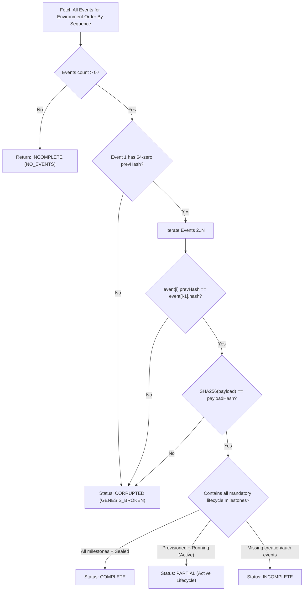

# Stage 5B.3 — Cryptographic Execution Evidence Chain & Verification

## 1. Overview

The Execution Evidence subsystem (`ExecutionEvidenceRecorderService`) guarantees verifiable, tamper-evident auditability for every action taken by or within a deception runtime environment.

Every lifecycle milestone, health transition, operator mutation, and anomaly generates an immutable evidence record. Records are cryptographically bound to their predecessors using an append-only SHA-256 hash chain, allowing any participant with tenant read privileges to audit the integrity, provenance, and completeness of the execution log.

---

## 2. Evidence Record Structure & Hash Chaining

Each record in the `DeceptionExecutionEvent` database table contains:

```
+-----------------------------------------------------------------------------------+
|                           DeceptionExecutionEvent                                 |
+-----------------------------------------------------------------------------------+
| id                 : String (CUID/UUID)                                           |
| tenantId           : String (UUID)                                                |
| environmentId      : String (UUID)                                                |
| eventType          : Enum (17 Lifecycle Event Types)                              |
| eventSequence      : Integer (1, 2, 3...)                                         |
| timestamp          : DateTime (ISO 8601)                                          |
| payload            : JSON (Sanitized event payload)                               |
| payloadHash        : String (SHA-256 of canonicalized payload)                   |
| prevEventHash      : String (SHA-256 of preceding event; '0'*64 for genesis)      |
| eventHash          : String (SHA-256 of sequence + type + prevHash + payloadHash) |
+-----------------------------------------------------------------------------------+
```

### 2.1. Cryptographic Invariants

1. **Genesis Block**: The first event (`eventSequence: 1`) must have `prevEventHash === "0000000000000000000000000000000000000000000000000000000000000000"`.
2. **Hash Linkage**: For every subsequent event $i > 1$, `event[i].prevEventHash === event[i-1].eventHash`.
3. **Payload Integrity**: `event[i].payloadHash === SHA256(canonicalJson(event[i].payload))`.
4. **Monotonic Sequences**: `event[i].eventSequence === event[i-1].eventSequence + 1`.
5. **Monotonic Timestamps**: `event[i].timestamp >= event[i-1].timestamp`.

---

## 3. Granular Lifecycle Event Types (17 Types)

The evidence recorder supports 17 distinct event types spanning the full deception lifecycle:

| Phase | Event Type | Trigger Description |
| :--- | :--- | :--- |
| **Provisioning** | `RUNTIME_PROVISION_REQUESTED` | Orchestrator receives allocation request with approved DSG. |
| | `AUTHORIZATION_VERIFIED` | Dual-custody token validated; quota verified. |
| | `CONTAINER_CREATED` | Docker daemon successfully creates container. |
| | `CONTAINER_STARTED` | Container entrypoint started and PID assigned. |
| | `NETWORK_ISOLATED` | Dedicated bridge network created with `Internal: true`. |
| **Observability** | `HEALTH_CHECK_EXECUTED` | Scheduled or live probe inspection completed. |
| | `TELEMETRY_INGESTED` | Synthetic interaction or telemetry packet logged. |
| | `MUTATION_REQUESTED` | Safe runtime mutation proposed (`PROPOSED_NOT_EXECUTED`). |
| | `MUTATION_EXECUTED` | Dual-custody mutation committed to runtime. |
| | `RUNTIME_DEGRADED` | Container resource usage or latency exceeded threshold. |
| | `RUNTIME_RECOVERED` | Degraded/unhealthy container returned to healthy state. |
| **Anomalies & Audit** | `ANOMALY_DETECTED` | Reconciliation detected drift or policy violation. |
| | `RECONCILIATION_COMPLETED`| Periodic 5-tier state consistency scan finished. |
| **Termination** | `TERMINATION_REQUESTED` | Operator or policy initiated environment teardown. |
| | `CONTAINER_STOPPED` | Container process halted gracefully. |
| | `NETWORK_REMOVED` | Synthetic bridge network deleted. |
| | `EVIDENCE_SEALED` | Final terminal marker closing the hash chain. |

---

## 4. Verification Algorithm & Completeness Reporting

The verification engine (`verifyEvidenceCompleteness`) evaluates the chain against both cryptographic validity and lifecycle milestone requirements:



### 4.1. Completeness Status Definitions

- **`COMPLETE`**: Cryptographically unbroken chain containing all lifecycle milestones from `RUNTIME_PROVISION_REQUESTED` to `EVIDENCE_SEALED`.
- **`PARTIAL`**: Cryptographically valid and unbroken chain for an active, currently running environment (contains provision milestones, but not yet terminated or sealed).
- **`INCOMPLETE`**: Cryptographically unbroken chain, but missing essential lifecycle milestones (e.g., container started without authorization record).
- **`CORRUPTED`**: Hash mismatch, broken previous hash linkage, payload alteration, non-monotonic sequence, or duplicate sequence detected.

---

## 5. Security Limitations and Non-Repudiation Invariants

> [!WARNING]
> **Cryptographic Limitations**:
> The evidence chain implements internal tamper detection within the backend application layer.
>
> - **`NON_REPUDIATION: NOT_IMPLEMENTED`**: Evidence records are hashed with standard SHA-256 and signed with symmetric backend secrets. Asymmetric digital signatures from individual operators (e.g., ECDSA / Ed25519) are not yet implemented.
> - **`INDEPENDENT_TRUST_ANCHOR: NOT_IMPLEMENTED`**: There is no external timestamping authority (RFC 3161 TSA) or public transparency log (e.g., Rekor / Certificate Transparency).
> - If an adversary achieves full compromise of the PostgreSQL database and backend application master key, historical records could theoretically be recomputed. However, any modification of records in-place without master key re-signing will immediately trigger a `CORRUPTED` integrity status.
