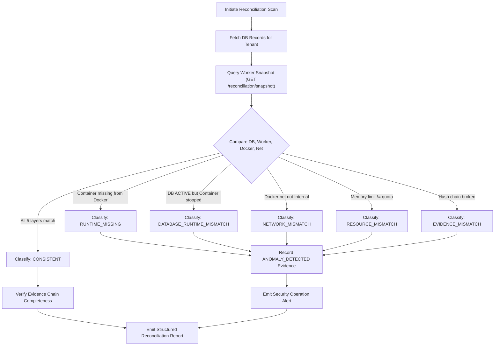

# Stage 5B.3 — Multi-Tier Runtime Lifecycle Reconciliation

## 1. Overview

In distributed containerized deception systems, state drift inevitably occurs between application persistence, orchestrator registries, and the underlying container runtime (e.g., container crash, external `docker rm`, node restart, or network corruption).

The Stage 5B.3 Lifecycle Reconciliation Engine (`RuntimeReconciliationService`) performs multi-tier comparative analysis across five distinct system layers to ensure absolute operational truth, prevent rogue container execution, and detect orphaned resources.

---

## 2. The 5-Layer Reconciliation Hierarchy

Reconciliation checks every managed environment across five independent sources of truth:

```
+-------------------------------------------------------------------------+
| Layer 1: PostgreSQL Database State                                      |
| - Record existence, tenantId, lifecycleState, containerId, networkId     |
+-------------------------------------------------------------------------+
                                   |
+-------------------------------------------------------------------------+
| Layer 2: Worker Process State                                           |
| - In-memory managedEnvironments map, managedNetworks map                 |
+-------------------------------------------------------------------------+
                                   |
+-------------------------------------------------------------------------+
| Layer 3: Docker Container Runtime State                                 |
| - Container status (running/exited), PID, cgroups memory & CPU limits   |
+-------------------------------------------------------------------------+
                                   |
+-------------------------------------------------------------------------+
| Layer 4: Docker Network Runtime State                                   |
| - Network existence, driver ('bridge'), Internal flag ('Internal: true')|
+-------------------------------------------------------------------------+
                                   |
+-------------------------------------------------------------------------+
| Layer 5: Append-Only Execution Evidence Chain                           |
| - Genesis block, SHA-256 chain continuity, lifecycle milestones         |
+-------------------------------------------------------------------------+
```

---

## 3. Discrepancy Classification & Deterministic Codes

When reconciling an environment or tenant, the reconciliation engine maps findings to deterministic codes:

| Discrepancy Code | Description | Trigger Condition |
| :--- | :--- | :--- |
| **`CONSISTENT`** | Perfect synchronization across all 5 layers. | DB active, Worker registered, Docker running, Network isolated, Evidence valid. |
| **`DATABASE_RUNTIME_MISMATCH`** | DB indicates active, but worker or container reports stopped or exited. | DB state is `ACTIVE` but Docker state is `exited` or `dead`. |
| **`RUNTIME_MISSING`** | DB records an active container, but container is completely absent from Docker daemon. | Docker returns 404 No Such Container for `containerId`. |
| **`ORPHAN_RUNTIME`** | A Docker container or network exists with deception labels, but has no DB record. | Label `deception.managed=true` found in Docker, absent from DB. |
| **`RESOURCE_MISMATCH`** | Container running cgroups limits do not match authorized quota. | `HostConfig.Memory` in Docker does not match DB quota / plan limit. |
| **`NETWORK_MISMATCH`** | Synthetic network is missing or violates egress quarantine (`Internal !== true`). | Docker network missing or `Internal: false` allows egress leak. |
| **`EVIDENCE_MISMATCH`** | Evidence chain is corrupted, incomplete, or tampered. | Hash linkage check fails or missing mandatory lifecycle events. |
| **`UNKNOWN`** | Reconciliation scan failed due to unreachable worker or daemon. | Worker IPC error or Docker communication timeout. |

---

## 4. Reconciliation Execution Flow

Reconciliation can be triggered on-demand via the REST API or scheduled periodically by background tasks:



---

## 5. Security Guardrails & Non-Destructive Invariants

To avoid secondary outages or evidence tampering, reconciliation enforces strict guardrails:

1. **Inconsistent Runtimes Are Never Marked Healthy**:
   - If any discrepancy is detected (`DATABASE_RUNTIME_MISMATCH`, `NETWORK_MISMATCH`, `RESOURCE_MISMATCH`), the environment cannot be displayed as `HEALTHY`. It is immediately marked `DEGRADED`, `UNHEALTHY`, or `UNKNOWN`.
2. **Never Silently Delete Runtimes**:
   - The reconciliation engine **NEVER** terminates or deletes containers automatically during a scan.
   - Deleting an anomalous container could destroy critical forensic evidence of an attacker compromise or escape attempt.
3. **Structured Operator Alerts**:
   - Anomalies are logged as structured alerts, surfaced to the frontend dashboard, and recorded in the audit log for human operator triage.
4. **Tenant Isolation**:
   - Runtimes, containers, and networks belonging to Tenant A are never compared against or affected by Tenant B's reconciliation scans.
