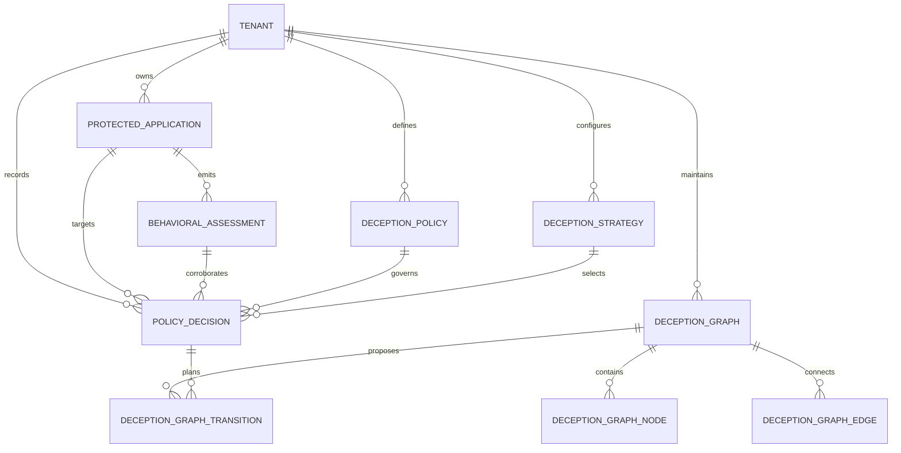

# Stage 5A — Adaptive Deception Policy Engine and Deception State Graph Planning

## Project: AI-Enabled Adaptive Cyber Deception Gateway
**Repository:** `https://github.com/TheCreativeCodeFlow/Final-Year-Project.git`  
**Milestone:** Stage 5A  
**Status:** Completed & Validated

---

## Executive Summary

Stage 5A formalizes the policy decision layer and state graph planning subsystem of the AI-Enabled Adaptive Cyber Deception Gateway. Building upon the secure reverse proxy (Stages 4A–4A.1), behavioral telemetry normalization (Stages 4B–4B.1), hybrid detection engine (Stages 4C–4C.3), and operations dashboard (Stage 4D), this milestone bridges **detection assessments** with **adaptive deception planning**.

Crucially, Stage 5A adheres strictly to the **12-stage architectural separation**:
$$\text{Observation} \longrightarrow \text{Feature Extraction} \longrightarrow \text{Detection Assessment} \longrightarrow \text{Deception Eligibility} \longrightarrow \text{Policy Evaluation} \longrightarrow \text{Strategy Selection} \longrightarrow \text{DSG Plan Generation} \longrightarrow \text{Policy Decision} \longrightarrow \text{Future Authorization} \longrightarrow \text{Future Routing Decision} \longrightarrow \text{Future Routing Outcome} \longrightarrow \text{Execution Evidence}$$

In Stage 5A:
- **No live traffic diversion, container provisioning, or honeypot execution is performed.**
- All generated graph mutations remain in status `PROPOSED`.
- All emitted records strictly enforce `executionEvidenceStatus: 'MISSING'` and `executionStatus: 'NOT_EXECUTED'`.

---

## 1. Domain Model Architecture

The existing PostgreSQL schema managed via Prisma ORM has been refined to establish immutable decision records, multi-layer graph modeling, and tenant-scoped policy rules:



### Key Models

1. **`DeceptionPolicy`**:
   - Tenant- and application-scoped governance rules.
   - Configurable `priority` (1 highest to 1000 lowest), `version` (optimistic version counter), `enabled` flag.
   - Structured `requiredEvidenceCriteria`: `minConfidence`, `requiredTelemetryQuality`, `minCorrelationConfidence`, `maxCollisionRisk`, `requireRuleCorroboration`, `applicableClassifications`, and `allowedStrategies`.
   - Bounded `permittedActions` and `prohibitedActions` with strict sandbox isolation constraints.

2. **`DeceptionStrategy`**:
   - Catalogue of strategies across 5 canonical deception categories.
   - Enforces prerequisites, isolation boundaries, and permitted state change proposals (no arbitrary commands).
   - Embedded `dsgBlueprint` defining prototype nodes and edges for dynamic simulation.

3. **`PolicyDecision`**:
   - Append-only, immutable record of every evaluation.
   - Links `assessmentId`, `policyId`, `policyVersion`, `selectedStrategyId`, `selectedStrategyVersion`, `candidateStrategyIds`, `dsgGraphId`, `proposedMutations`, `reasonCodes`, `decisionResult`, `decisionRationale`, and `evaluatorVersion: '5A.1'`.
   - Embeds evidence ground truth with `executionEvidenceStatus: 'MISSING'`.

4. **`DeceptionGraph` & `DeceptionGraphTransition`**:
   - Represents the Deception State Graph (DSG) across 3 distinct topological layers.
   - `DeceptionGraphTransition` captures proposed mutations (`previousState` vs `proposedState`) with status strictly restricted to `PROPOSED`, `VALIDATED`, `REJECTED`, or `PENDING_EXECUTION`.

---

## 2. Research Evaluation & Findings

### RQ1: Policy Expressiveness & Guardrail Effectiveness
> *How do multi-criteria deception policies prevent unjustified traffic diversion while allowing responsive deception planning?*

#### Analysis
In an enterprise multi-tenant gateway, diverting legitimate users into a honeypot represents a severe service outage and privacy violation. Conversely, failing to divert confirmed malicious actors degrades the defensive utility of deception.

To solve this tension, the Stage 5A Policy Evaluation Engine implements a multi-tier evidence gating sequence:

1. **Safe Default Principle**: When no policy exists or the active policy is disabled, the evaluation defaults safely to `POLICY_NOT_CONFIGURED` or `ALLOW_NORMAL`. No diversion proposal can ever occur in the absence of explicit, enabled tenant authorization.
2. **Telemetry Integrity Safeguard**: If `telemetryLossDetected: true` or `dataQualityState === 'DEGRADED'`, evaluation immediately returns `INSUFFICIENT_EVIDENCE` with reason code `TELEMETRY_LOSS_DEGRADATION`. An attacker cannot induce diversion of benign sessions by intentionally flooding or degrading the telemetry recorder.
3. **ML-Only Anomaly Guardrail**: If an anomaly is flagged by Branch B (Isolation Forest) but lacks deterministic security rule corroboration, the engine returns `INSUFFICIENT_EVIDENCE` with reason code `ML_ONLY_UNVERIFIED_ANOMALY`. Unsupervised models are susceptible to concept drift and novel benign usage; requiring deterministic corroboration prevents false-positive diversion.
4. **Collision Risk Limit**: If session attribution uncertainty or shared IP proxies indicate a non-zero risk of legitimate user collision (`maxCollisionRisk: 'LOW'`), the engine declines deception planning, returning `ALLOW_NORMAL`.
5. **Confidence & Correlation Gates**: Evaluations must meet both mathematical confidence ($\ge \theta_{\text{min}}$, e.g. 0.75) and session correlation confidence ($\ge \gamma_{\text{min}}$, e.g. 0.65).

This multi-criteria gate ensures that deception planning is activated **only** when high-confidence, corroborated, un-degraded attack evidence is demonstrated.

---

### RQ2: Deterministic Strategy Selection across the 5 Categories
> *How does deterministic strategy selection across the 5 categories map distinct attack signatures to realistic deception mechanics without human-in-the-loop latency or stochastic hallucinations?*

#### Analysis
Stage 5A categorizes cyber deception into five distinct operational domains:

| Category | Targeted Attack Signatures | Deception Mechanics | Sandbox Isolation |
| :--- | :--- | :--- | :--- |
| **`RECONNAISSANCE_DECEPTION`** | `RULE_REPEATED_RESOURCE_PROBING`, scanner endpoints (`/admin`, `/.env`) | Synthetic administrative status APIs, decoy diagnostic routes, canary token seeds. | `SYNTHETIC_MOCK_ROUTER`, `STRICT_NO_EGRESS` |
| **`CREDENTIAL_DECEPTION`** | `RULE_BRUTE_FORCE_AUTH`, rapid authentication failure spikes | High-entropy canary JWT bearer tokens with embedded tripwire claims. | `HONEY_AUTH_PROVIDER`, `STRICT_NO_EGRESS` |
| **`API_DECEPTION`** | `RULE_SUSPICIOUS_METHOD`, unsupported HTTP verb fuzzing | Shadow OpenAPI / GraphQL introspection facades returning realistic schema stubs. | `SHADOW_API_GATEWAY`, `STRICT_NO_EGRESS` |
| **`DATA_ACCESS_DECEPTION`** | `RULE_DATA_ACCESS`, SQL injection probes, unauthorized enumerations | Synthetic SQL tables with decoy customer balances and canary account records. | `SYNTHETIC_DATA_SANDBOX`, `STRICT_NO_EGRESS` |
| **`SERVICE_INTERACTION_DECEPTION`** | `RULE_HIGH_FREQUENCY_BURST`, automated crawler floods | Asynchronous progressive delay tarpit ($250\,\text{ms} \to 5000\,\text{ms}$) depleting attacker concurrency. | `TARPIT_RATE_CONTAINER`, socket hold |

#### Deterministic Selection Algorithm
The `StrategySelectionService` executes without non-deterministic LLM calls or stochastic heuristics:
1. **Category Inference**: Inferred from rule findings (`ruleId`) and behavioral feature vectors.
2. **Policy Allowance Check**: Rejects candidates excluded by tenant policy `allowedStrategies`.
3. **Prerequisite Verification**: Compares assessment confidence, telemetry quality, and rule corroboration against strategy constraints.
4. **Scoring & Ranking**:
   $$\text{Score} = 50 \cdot \mathbb{I}(\text{Category Match}) + 20 \cdot \sum \mathbb{I}(\text{Targeted Rule Corroborated}) + \lfloor 20 \cdot \text{Confidence} \rfloor$$
5. **Tiebreaking**: Deterministic lexicographical sorting on `strategyIdentifier`.

This eliminates latency and non-reproducibility while generating machine-readable audit explanations for SecOps operators.

---

### RQ3: Deception State Graph (DSG) Topology and Layer Isolation
> *How does the 3-layer DSG model ensure strict security isolation, preventing synthetic decoys or lateral movement traps from compromising real infrastructure?*

#### Analysis
A primary failure mode of dynamic honeypots is **attacker breakout**, where a compromised decoy environment is leveraged as a pivot or proxy to attack the internal network. The Deception State Graph enforces structural containment through 3 strictly decoupled layers:

```
+-----------------------------------------------------------------------------------+
| LAYER 1: PROTECTED_DECEPTION_POLICY                                               |
| - Immutable Containment Rules                                                     |
| - Strict Namespace Isolation Boundaries                                           |
| - Prohibited Actions: NO_OUTBOUND_EGRESS, NO_ARBITRARY_COMMAND                    |
+-----------------------------------------------------------------------------------+
                                         │ Governs
                                         ▼
+-----------------------------------------------------------------------------------+
| LAYER 2: CONTROLLED_DYNAMIC_STATE                                                 |
| - Synthetic Endpoints (/api/v1/internal/admin)                                    |
| - Honey Credential Generators (Canary JWT Tokens)                                 |
| - Isolated Decoy Data Stores (Synthetic SQL Vaults)                               |
+-----------------------------------------------------------------------------------+
                                         │ Observes
                                         ▼
+-----------------------------------------------------------------------------------+
| LAYER 3: OBSERVATIONAL_ATTACKER_STATE                                             |
| - Probe Trajectory Trackers                                                       |
| - Lateral Movement Traps (Triggers alarm on canary token use)                     |
| - Interaction Depth Recorders & Exfiltration Sinks                                |
+-----------------------------------------------------------------------------------+
```

#### Layer Isolation Properties
1. **Layer 1 (Policy)** is immutable from within the graph. Decoy nodes in Layer 2 cannot modify Layer 1 boundary rules.
2. **Layer 2 (Decoys)** operate exclusively as synthetic state machines or isolated mock engines. No decoy node possesses network egress or underlying host execution privileges.
3. **Layer 3 (Observation)** acts as a read-only sink. Trapping an attacker in a lateral movement trap registers telemetry without allowing the attacker to reach live upstream origin servers.

---

### RQ4: Audit Provenance and the Non-Execution Invariant
> *Why is the architectural decoupling of detection $\to$ policy evaluation $\to$ strategy selection $\to$ DSG mutation planning $\to$ policy decision essential for ethical, defensible AI-enabled deception?*

#### Analysis
In automated security systems, conflating *planning* with *execution* creates severe research evaluation bias and real-world operational hazards:
- If a prototype claims autonomous traffic diversion when it only executed a simulated heuristic, benchmark results become untruthful and unverifiable.
- In production, executing diversion without immutable policy provenance prevents post-incident forensic audits and regulatory accountability.

Stage 5A enforces this boundary at both schema and runtime levels:
1. **Decision Record Immobility**: A `PolicyDecision` records the mathematical recommendation (`PROPOSE_DECEPTION`, `ALLOW_NORMAL`, etc.) with reason codes and policy versioning. It does **not** command the gateway reverse proxy to alter socket routing.
2. **Graph Mutation Status**: All transitions planned by `DSGPlannerService` are marked `transitionStatus: 'PROPOSED'`. They are never marked `EXECUTED`.
3. **Execution Evidence Status**: Every emitted API response, decision record, and assessment explicitly reports:
   $$\text{executionEvidenceStatus} = \text{'MISSING'}$$
   $$\text{executionStatus} = \text{'NOT_EXECUTED'}$$

This guarantees that future execution milestones (Stage 5B/5C) can be benchmarked against a rigorous, verifiable planning baseline without retrospective contamination.

---

## 3. Verification & Test Coverage Summary

The Stage 5A test suite (`backend/tests/deception-policy-engine.test.js`) verifies all 21 core behavioral, policy, and API requirements:

| Test ID | Requirement Verified | Status |
| :--- | :--- | :--- |
| **Test 1** | Safe default: Null or missing policy returns `POLICY_NOT_CONFIGURED` without diversion | **PASSED** |
| **Test 2** | Disabled policy returns `POLICY_NOT_CONFIGURED` and refuses diversion | **PASSED** |
| **Test 3** | Ineligible assessment (`deceptionEligible: false`) rejects deception proposal | **PASSED** |
| **Test 4** | ML-only anomaly without rule corroboration returns `INSUFFICIENT_EVIDENCE` | **PASSED** |
| **Test 5** | Telemetry loss or degraded quality returns `INSUFFICIENT_EVIDENCE` | **PASSED** |
| **Test 6** | Benign assessment returns `ALLOW_NORMAL` without diversion | **PASSED** |
| **Test 7** | Assessment confidence below policy minimum returns `INSUFFICIENT_EVIDENCE` | **PASSED** |
| **Test 8** | Deterministic strategy selection across all 5 deception categories | **PASSED** |
| **Test 9** | No matching strategy returns `NO_ELIGIBLE_STRATEGY` with rejected candidates | **PASSED** |
| **Test 10** | Fully eligible attack generates `PROPOSE_DECEPTION` with DSG mutation plan | **PASSED** |
| **Test 11** | DSG Planner generates valid nodes across all 3 canonical layers | **PASSED** |
| **Test 12** | Invariant: DSG transition status is strictly `PROPOSED`, never `EXECUTED` | **PASSED** |
| **Test 13** | Decision recorder creates immutable decision record with provenance | **PASSED** |
| **Test 14** | `GET /deception/policies` lists tenant policies and baselines | **PASSED** |
| **Test 15** | `POST /deception/policies` creates tenant policy and records audit event | **PASSED** |
| **Test 16** | `PATCH /deception/policies/:id` updates policy and increments version | **PASSED** |
| **Test 17** | `GET /deception/strategies` returns full 5-category catalogue with notice | **PASSED** |
| **Test 18** | `POST /deception/evaluate` evaluates assessment and records immutable decision | **PASSED** |
| **Test 19** | `GET /deception/decisions` lists recorded decisions with tenant isolation | **PASSED** |
| **Test 20** | `GET /deception/graphs/:id` returns 3-layer topology and non-execution notice | **PASSED** |
| **Test 21** | Cross-tenant isolation: MedSecure analyst denied access to Apex decisions (403) | **PASSED** |

### Regression Suites Summary
- **Backend Test Suite**: **322 passed across 45 suites** (0 failed, 0 cancelled).
- **Gateway Runtime Suite**: **37 passed across 2 suites** (0 failed).
- **Frontend Production Build**: **Completed in 1.54s** with 0 errors.

---

## Conclusion

Stage 5A successfully implements the Adaptive Deception Policy Engine, Deterministic Strategy Selection, and Deception State Graph Planning subsystem. All architectural constraints, tenant isolation boundaries, and research integrity guarantees have been strictly preserved.
